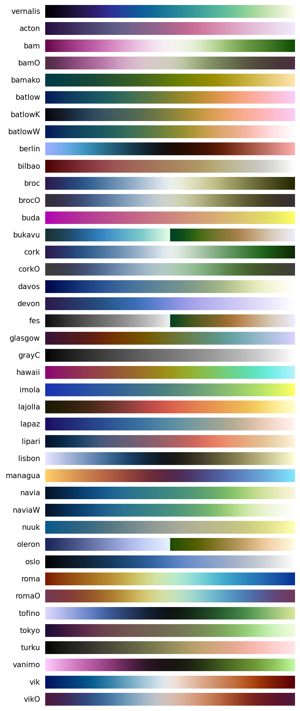

## degas

A collection of plotting utilities and helper functions for matplotlib.

## Installation and requirements

Dependencies
+ matplotlib
+ numpy
+ scipy

Optional dependencies
+ `ipywidgets` (for `sliderplot`, install with `degas[interactive]`)

Install with `uv` or `pip`:

```bash
uv add degas
# or
pip install degas
# or directly from GitHub
pip install git+https://github.com/williamgilpin/degas
```


## Example usage

```python3
import numpy as np
from degas.degas import plot_err
   
x = np.linspace(0, 1, 100)
y = x**3
err = .05 * np.random.random(len(x))

plot_err(y, err, x=x)
```

## Styles

`degas` ships with a set of matplotlib style sheets in the `degas/styles` folder, sharing a
common base (`base.mplstyle`: Helvetica font stack, `vernalis` default colormap, and transparent
300 DPI exports):

+ `base`: shared Helvetica typography, `vernalis` colormap, and transparent high-DPI export defaults
+ `default`: matplotlib's built-in defaults plus the shared base and degas high-contrast color cycle
+ `degas_figure`: compact paper-figure style with inward ticks, gray axes, and the degas high-contrast color cycle
+ `pastel_rainbow`: similar to `degas_figure`, with the 12-color degas pastel rainbow color cycle
+ `dark`: presentation-oriented dark style with transparent canvas, light-gray spines (`#D9D9D9`), outward muted ticks (`#8C8C8C`), larger white axis labels, bold `cornflower_blue`-led strokes, and frameless legends for talks and slides

Activate a style with `set_style`, which applies it to all subsequent plots:

```python3
import degas as dg

dg.set_style("degas_figure")
```

The styles are ordinary matplotlib style sheets, so they can also be used directly with
`plt.style.use`. The path to the styles folder is available as `dg.data_path`:

```python3
import os
import matplotlib.pyplot as plt
import degas as dg

plt.style.use(os.path.join(dg.data_path, "degas_figure.mplstyle"))

# or apply a style to a single figure only
with plt.style.context(os.path.join(dg.data_path, "pastel_rainbow.mplstyle")):
    plt.plot([0, 1], [0, 1])
```

Note: All house styles prefer Helvetica and fall back cleanly to Arial, Open Sans, or DejaVu Sans
if Helvetica is not installed.

## Colormaps

All colormaps in the `degas/colormaps` folder are available as top-level attributes, along
with reversed versions with an `_r` suffix. Importing `degas` also registers them with
matplotlib, so they can be passed by name as `cmap="vernalis"`. These include
[vernalis](https://gist.github.com/mwaskom/9f4c519e185637a4d0a7dd7bd900207e) as well as the
[Scientific colour maps](https://www.fabiocrameri.ch/colourmaps/) (batlow, roma, vik, etc.):

```python3
import numpy as np
import matplotlib.pyplot as plt
import degas as dg

data = np.random.random((32, 32))
plt.imshow(data, cmap=dg.vernalis)
plt.imshow(data, cmap=dg.batlow_r)
```



The image above can be regenerated with `python assets/generate_colormap_figure.py`.

## Examples & Agent Skill

Runnable examples covering all house styles (including `dark`) and plotting helpers live in [`examples/`](examples/README.md):

```bash
uv run python examples/styles_showcase.py
uv run python examples/scientific_helpers.py
```

An Agent Skill for creating publication-grade figures with `degas` is included under [`skills/scientific-plotting/`](skills/scientific-plotting/SKILL.md).

## Development & Testing

```bash
uv sync
MPLBACKEND=Agg uv run python -m unittest discover -s tests -p "test_*.py"
```
